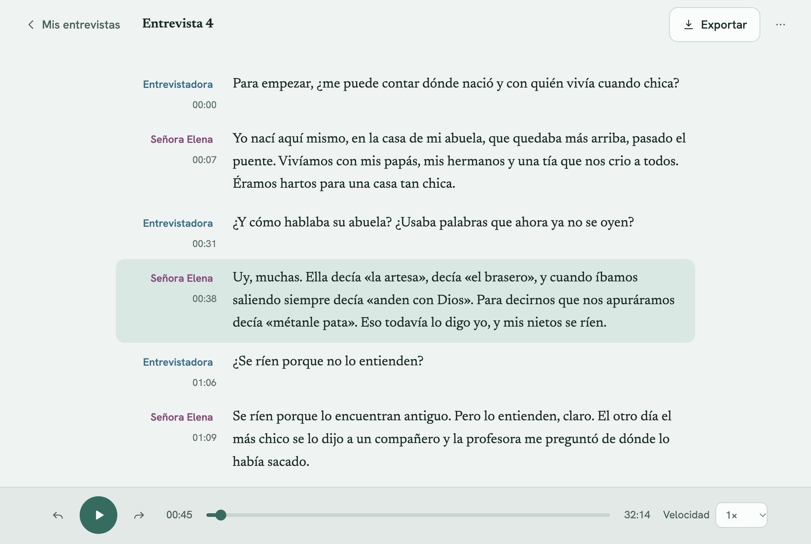

# Escriba

Escriba graba entrevistas y las transcribe en tu propio computador. Nada se sube a internet: el audio y el texto no salen de tu equipo, y funciona sin conexión una vez instalado.

## Descargar

| Tu computador | Archivo |
| --- | --- |
| **Windows** 10 u 11 | [Descargar Escriba para Windows](https://github.com/garbanzo96/escriba/releases/latest/download/Escriba-Windows.exe) |
| **Mac** con macOS 13 o posterior | [Descargar Escriba para Mac](https://github.com/garbanzo96/escriba/releases/latest/download/Escriba-Mac.dmg) |

El archivo es grande (entre 700 y 900 MB) porque trae todo adentro, también el modelo que reconoce la voz. Puede demorar varios minutos en bajar. No hay que instalar ni configurar nada más.

## Instalar en Windows

1. Abre el archivo `Escriba-Windows.exe` que descargaste.
2. Si el navegador dice que el archivo no se descarga habitualmente, elige **Conservar** (en Edge: los tres puntos, **Conservar**, **Mostrar más**, **Conservar de todos modos**).
3. Si aparece una ventana azul que dice «Windows protegió su PC», pulsa **Más información** y después **Ejecutar de todas formas**.
4. Espera uno o dos minutos. Escriba se abre solo y queda un acceso directo en el escritorio.

El aviso azul aparece porque Escriba es gratuita y no tiene una firma comercial pagada. Solo sale la primera vez.

## Instalar en Mac

1. Abre el archivo `Escriba-Mac.dmg` que descargaste.
2. Arrastra el ícono de Escriba hasta la carpeta Aplicaciones (Applications) que está al lado. Espera a que termine de copiarse.
3. Abre Escriba desde Aplicaciones. El Mac va a decir que no puede comprobar la app: pulsa **Aceptar** o **Listo** (nunca «Mover a la papelera»).
4. Abre **Configuración del Sistema** (o Ajustes del Sistema), entra a **Privacidad y seguridad** y baja hasta el final. Verás un mensaje sobre Escriba: pulsa **Abrir de todos modos** (o «Abrir igualmente») y confirma con tu clave o tu huella.
5. Cuando grabes por primera vez, el Mac preguntará si Escriba puede usar el micrófono. Pulsa **Permitir**.

El paso 4 se hace una sola vez. El aviso aparece porque Escriba es gratuita y no tiene una firma comercial pagada.

## Usar Escriba

**Para grabar:** pulsa **Grabar una entrevista**, escribe un título y pulsa el botón rojo. Puedes pausar y seguir. No cierres la tapa del computador mientras grabas, porque se duerme y deja de grabar. Al final pulsa **Terminar y transcribir**.

**Si ya tienes la grabación** (del celular, de WhatsApp, de una grabadora): pulsa **Abrir una grabación**, o arrastra el archivo hasta la ventana. Sirve casi cualquier formato de audio o video.

**Mientras se transcribe** el texto va apareciendo. Puedes hacer otra cosa, o cerrar Escriba: cuando la abras de nuevo sigue donde quedó.

**Para corregir:** toca el minuto que está al lado de un párrafo y sonará desde ahí. El párrafo que suena se ilumina. Escribe directamente sobre el texto; se guarda solo.

| Tecla | Qué hace |
| --- | --- |
| Esc | Reproduce o pausa (al seguir, retrocede 1 segundo) |
| Alt + ← o → | Retrocede o avanza 3 segundos |
| Alt + ↑ o ↓ | Más rápido o más lento (de 0,5× a 2×) |
| Alt + 1, 2, 3… | Marca quién habla en el párrafo |
| Enter | Parte el párrafo en dos |
| Retroceso, al inicio del párrafo | Lo une con el anterior |

En el teclado del Mac, la tecla Alt es **Opción** (⌥).

**Para marcar quién habla:** toca la etiqueta «Quién habla» y elige. Ahí mismo puedes agregar personas o cambiarles el nombre. También puedes dejar que suene el audio e ir pulsando Alt + 1 o Alt + 2 según quién habla.

**Para usar el resultado:** el botón **Exportar** entrega un documento de Word o un archivo de texto, con los minutos y los nombres.

## Dónde quedan las entrevistas

En una carpeta llamada **Escriba** dentro de tu carpeta personal, una por entrevista, con el audio y el texto. En Escriba puedes llegar desde **Exportar**, **Abrir la carpeta de esta entrevista**.

Escriba no hace copias de respaldo. Copia esa carpeta cada cierto tiempo a un pendrive o disco externo: si el computador falla, es lo único que las salva.

Desinstalar Escriba no borra tus entrevistas.

## Privacidad

- La transcripción la hace Whisper, un modelo que corre dentro de tu computador. No se usa ningún servicio externo ni ninguna otra inteligencia artificial.
- Escriba bloquea sus propias conexiones a internet y no recoge datos de uso.
- La carpeta Escriba queda fuera de Documentos y del Escritorio para que OneDrive o iCloud no la suban solos a la nube.
- Los archivos no van cifrados. Si trabajas con datos sensibles, protege el computador con clave y activa el cifrado del disco (BitLocker en Windows, FileVault en Mac).

## Antes de analizar las transcripciones

La transcripción automática se equivoca, sobre todo con nombres propios, voces superpuestas y audio con ruido. Y hay algo importante para análisis lingüístico: **Whisper tiende a limpiar el habla**. Suele omitir muletillas, repeticiones, titubeos y palabras cortadas, y a veces normaliza formas coloquiales. Si eso es parte de lo que estudias, agrégalo tú mientras escuchas. El audio original queda siempre completo y sin cambios.

Escriba no distingue las voces por sí sola: quién habla se marca a mano.

## Cuánto demora

Depende del computador. En un Mac reciente, una hora de entrevista toma unos 10 minutos. En un notebook con Windows puede tomar más o menos lo mismo que dura la entrevista, y más si es antiguo. En equipos muy básicos (procesadores Celeron, Pentium o Atom) puede tomar muchas horas: ahí conviene dejarlo transcribiendo en la noche. Déjalo enchufado y con otros programas cerrados.

Se necesitan 8 GB de memoria y unos 3 GB libres en el disco. Cada hora grabada ocupa unos 350 MB.

## Si algo falla

- **No encuentra el micrófono o no graba.** Revisa que esté conectado y que Escriba tenga permiso. En Windows: Configuración, Privacidad, Micrófono, «Permitir que las aplicaciones de escritorio accedan al micrófono». En Mac: Configuración del Sistema, Privacidad y seguridad, Micrófono.
- **Dice «Hubo un problema».** Abre la entrevista y pulsa **Reintentar**. El audio sigue guardado.
- **El texto salió mal en una parte.** En los tres puntos, **Volver a transcribir** lo rehace entero (se pierden las correcciones).
- **El Mac dice que Escriba está dañada.** Bórrala de Aplicaciones, descárgala otra vez y repite los pasos.
- **Sigue fallando.** En la carpeta Escriba hay un archivo `registro-de-problemas.txt`: mándaselo a quien te la pasó. Anota errores técnicos y los títulos de las entrevistas donde ocurrieron, no su contenido.

## Para quien quiera modificarla

Electron más whisper.cpp. Con Node 22 y CMake: `npm ci`, `./construir/preparar.sh` (baja los modelos y compila Whisper) y `npm start`. `npm run prueba` transcribe una muestra y `npm run prueba-interfaz` recorre la app completa. Al subir una etiqueta `v…`, [GitHub construye los instaladores](.github/workflows/instaladores.yml), los instala en Windows, Mac Apple y Mac Intel, los prueba y los publica. Las licencias de lo incluido están en [LICENCIAS.md](LICENCIAS.md).
